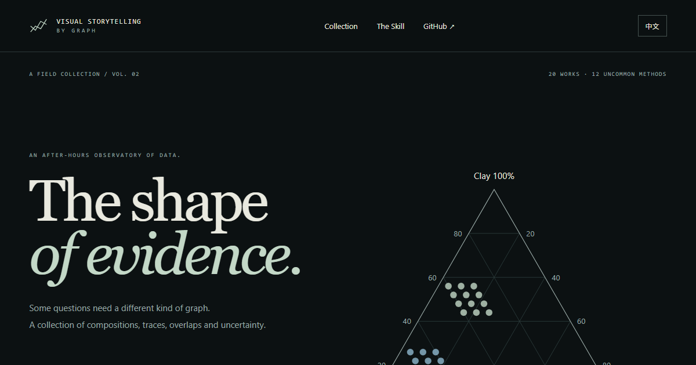

# visual-storytelling-by-graph

[中文](README.md) · [Immersive gallery](https://plevantem.github.io/visual-storytelling-by-graph/) · [Skill](SKILL.md) · [Verification ledger](verification/REPORT.md)

**From the user's question to an appropriate visual expression.** An Agent Skill for chart selection, data semantics, narrative, purposeful interaction and layered verification, accompanied by a reproducible gallery.



20 works · 12 new specialist methods · 31 display states · 24 simulated requests. All data is synthetic. Engineering checks and independent Agent executions do not establish human comprehension or aesthetic effectiveness.

## Install

Requires Node.js 22.20+ for the [skills CLI](https://github.com/vercel-labs/skills):

```sh
npx skills add PlevanTem/visual-storytelling-by-graph --skill visual-storytelling-by-graph
```

Choose your Agent during installation; add `-g` for global installation. Alternatively, [download the complete repository ZIP](https://github.com/PlevanTem/visual-storytelling-by-graph/archive/refs/heads/main.zip) and provide its root `SKILL.md` to a compatible Agent. The repository root is the Skill root.

```text
Use $visual-storytelling-by-graph.
I need a printable report comparing total service demand and demand per resident.
Data: service-demand.csv. Verify units and denominators, choose the expression,
and distinguish executed checks from unexecuted tests.
```

The core instructions are tool-independent. Simple requests stay short; complex tasks load only relevant references. A table, a direct number, missing-data request or no-chart outcome can be appropriate.

## Collection

[Enter the gallery](https://plevantem.github.io/visual-storytelling-by-graph/). Buildless HTML/CSS/JS, with no framework, CDN, remote font or server dependency.

- A dark observatory-like composition, asymmetrical collection and full-screen exhibits.
- English/Chinese UI, category filters, keyboard navigation, Escape and restored focus.
- State controls for ternary groups, exact intersections, recurrence thresholds, KDE bandwidth and conversion sources.
- Contextual SVG downloads and original JSON fixtures; standalone SVG links remain without JavaScript.
- Each work explains its question, method, data requirements and interpretation limits.

Specialist cases include ternary compositions, area-scaled wind rose, Kaplan–Meier with censoring, Bland–Altman agreement, UpSet-style exact intersections, object-level alluvial paths, scalar recurrence, mirrored horizon, ordered phase trajectory, ridgeline KDE, exact-x beeswarm and STFT magnitude. Eight foundational examples cover accounting contributions, empirical distributions, pairing, stratification, missing coverage, geographic normalization, uncertainty and exact lookup.

Novelty is conditional, not a quality certificate. Sources and engineering adaptations are separated in [the source index](references/sources.md).

## Reproduce

Python 3.10+, standard library for deterministic building and validation:

```sh
python scripts/build_examples.py
python scripts/build_gallery.py
python scripts/validate_bundle.py
python -m http.server 8037 --directory docs
```

Open `http://localhost:8037/`. Optional browser QA requires an existing Python Playwright/Chromium installation:

```sh
python scripts/browser_qa.py --url http://127.0.0.1:8037/
```

Nothing is automatically installed. `--initial` skips the remote repository ZIP download. Evidence is bound to input hashes and must be refreshed after relevant changes.

`evals/requests` holds 24 requests; `evals/fixtures` holds 23 JSON fixtures; separate `evals/cases.json` contains evaluation constraints and answers. Independent executors must not read those answers first. The source site is in `site/`, generated Pages content in `docs/`, and evidence in `verification/`.

## Evidence boundaries

See the [current report](verification/REPORT.md) for executed structural, numerical, actual-SVG, browser and independent behavioral checks. Human-reader understanding, aesthetic preference, controlled no-Skill/Skill comparisons, physical devices and cross-browser effects remain separate tests. No uncalibrated professionalism score is reported.

GitHub Pages publishes `main` / `docs`. CI validates committed artifacts and calculations; it does not claim new-browser verification from existing screenshots.
