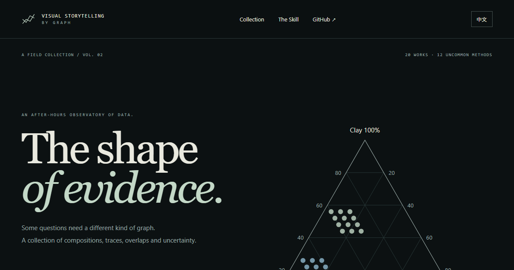

# visual-storytelling-by-graph

[English](README.en.md) · [沉浸式图表画廊](https://plevantem.github.io/visual-storytelling-by-graph/) · [Skill](SKILL.md) · [验证记录](verification/REPORT.md)

**从用户想回答的问题，到恰当的图表、叙事和交互。** 一个可以直接指导 Agent 的本地 Skill，以及一座可复查的图表画廊。



20 件作品 · 12 种新增专门表达 · 31 个展示状态 · 24 个模拟用户请求。全部数据为合成数据；工程检查和独立执行不等于真实读者理解或审美效果得到验证。

## 安装

在项目中执行（需要 Node.js 22.20+，安装器由 [skills CLI](https://github.com/vercel-labs/skills) 提供）：

```sh
npx skills add PlevanTem/visual-storytelling-by-graph --skill visual-storytelling-by-graph
```

安装器可让你选择 Agent；全局安装可加 `-g`。也可 [下载完整 ZIP](https://github.com/PlevanTem/visual-storytelling-by-graph/archive/refs/heads/main.zip)，解压后将包含 `SKILL.md` 的目录交给支持本地 Skill 的 Agent。仓库根目录就是 Skill 根目录。

```text
使用 $visual-storytelling-by-graph。
我是区域负责人，要判断哪里总需求最大、哪里人均需求最强。
数据在 service-demand.csv。交付一页可打印报告。
请核对单位和分母，说明选图理由，并明确哪些验证实际执行过。
```

核心指令不依赖特定图表库；实现使用 Agent 当前环境已有能力。简单任务快速完成，复杂任务按需查阅参考资料。表格、直接数值、补数据或暂不制图都可以是正确结果。

## 画廊

[进入 GitHub Pages 画廊](https://plevantem.github.io/visual-storytelling-by-graph/)。静态 HTML / CSS / JS，无框架、CDN、远程字体或服务端依赖。

- 夜间观测站式版面、非等宽作品编排、全屏展览和作品解读。
- 中英文界面；类别筛选；方向键前后切换；Esc 退出；焦点恢复。
- 三元分组、集合筛选、递归阈值、KDE 带宽和转化来源的状态切换。
- 当前状态 SVG 导出和原始 JSON 数据下载；无 JavaScript 时可以直接查看独立 SVG。
- 每件作品保留数据前提、选择理由、计算含义和解释边界。

| 新增表达 | 模拟场景 | 必须保留的信息 |
|---|---|---|
| 三元组成 | 河口、沙丘、黄土颗粒组成 | 非负、闭合到100%、重心坐标 |
| 面积归一风玫瑰 | 港口方向与速度观测 | 来向约定、分母、面积而非半径正比 |
| Kaplan–Meier | 档案材料右删失耐久 | 事件、删失、风险集、观察终点 |
| Bland–Altman | 声学测量方法一致性 | 配对差值、偏差、LoA与容许差异的区别 |
| UpSet 精确交集 | 多标签档案对象 | 精确模式、去重、包含与排除 |
| 对象级 Alluvial | 设备维修路径 | 真实转移、人数守恒与恒定带宽 |
| 标量递归图 | 重复与漂移信号 | 固定阈值、共同尺度、非对角分母 |
| Mirrored Horizon | 多站点温度距平 | 符号、分带、折叠和范围 |
| 循环相轨迹 | 有记忆的输入响应 | 顺序、方向、同输入多响应 |
| 山脊 KDE | 潮汐浊度分布 | 同一密度尺度、带宽、样本量 |
| 精确值蜂群 | 相同均值的等待分布 | 原值、重复值与尾部，不水平抖动 |
| STFT 幅度谱 | 扫频与固定频率叠加 | 窗、步长、采样率、dB参考、非PSD |

另有收入桥、ECDF、配对变化、分组率、缺测时序、地域口径、点区间和精确对账等8件作品。小众形式是条件性选择，不是“高级”标签。

## Skill 结构

```text
SKILL.md                 核心流程与按需路由
agents/openai.yaml       发现与调用元数据
references/              意图、图表族、专门方法、叙事、交互、验证、来源
evals/requests/          24个模拟真实请求
evals/fixtures/          23份固定JSON数据
evals/cases.json         独立评审约束与事实答案
examples/                原有8个基础示例，可离线查看
site/                    画廊页面源文件
docs/                    生成后的GitHub Pages站点
scripts/                 构建、审计和验证
verification/            数值、浏览器、独立执行与发布证据
```

主要研究视角：Munzner 的分层设计与验证、Brehmer 与 Munzner 的任务抽象、Segel 与 Heer 的叙事控制、Yi 等的交互意图，以及 Lex 等的集合表达和专门方法。原始来源、实际采用内容与不能推出的结论见 [来源索引](references/sources.md)。

## 本地重建与验证

核心构建和确定性验证只需要 Python 3.10+ 标准库：

```sh
python scripts/build_examples.py
python scripts/build_gallery.py
python scripts/validate_bundle.py
python -m http.server 8037 --directory docs
```

打开 `http://localhost:8037/`。另一个终端可运行浏览器检查（需已有 Python Playwright 与 Chromium）：

```sh
python scripts/browser_qa.py --url http://127.0.0.1:8037/
```

浏览器脚本不自动安装依赖。验证记录绑定文件哈希，改动后需重跑受影响检查。网络下载另行核验；`--initial` 可跳过远端仓库 ZIP 下载。

CSV审计：

```sh
python scripts/audit_data.py your-data.csv --output audit.json
```

审计不修改原文件，也不推断单位、分母、配对或因果。数值外观不代表业务度量。

## 已验证与未验证

以 [当前报告](verification/REPORT.md) 为准。确定性检查、真实 Chromium 操作、作者看图与独立 Agent 前测分别记录。真实读者理解、审美、基线 A/B、实体设备和跨浏览器效果仍需单独测试，不用“专业度分数”冒充实证结果。

GitHub Pages 从 `main` 的 `/docs` 发布；CI只核对提交的产物与数据，不把旧截图当作新环境的浏览器测试。基础技能支持中文与英文请求；案例及图表并不构成真实行业建议。
